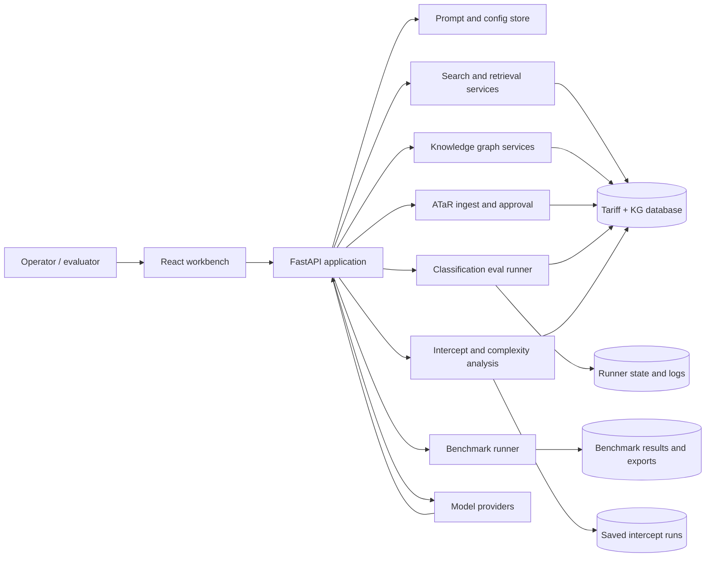
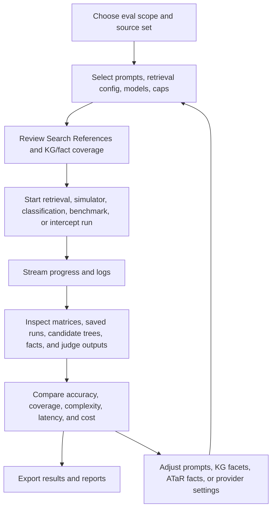

# AI Search Evaluation Suite

AI Search Evaluation Suite contains the evaluation worker used by Trade Tariff
Admin and retained research tools. The default launchers and worker images run
`backend.worker_app:app`. They do not serve the React workbench or research APIs.
See the [worker contract](#worker-contract).

The research source includes a React workbench, local evaluation runners,
knowledge graph tools, ATaR workflows, intercept analysis, and provider
benchmarks. These are not features of the default worker deployment.

## Research Features

- Runs retrieval/search experiments over tariff candidates, reference material,
  prompt variants, and provider/model configurations.
- Provides a prompt and configuration workbench for comparing retrieval,
  classification, judge, simulator, and benchmark settings.
- Exposes Search References for reviewing the source context used by retrieval,
  prompt generation, classification, and audit panels.
- Runs classification evaluations with a trader simulator, commodity-code (CC)
  fact sheets, Q&A turns, saved runs, and matrix-style result inspection.
- Supports ATaR ingest, draft generation, fact extraction, review, and approval
  flows.
- Provides a Knowledge workbench for KG coverage, facets, edges, graph browse,
  provenance/audit review, and controlled edit/delete operations.
- Runs benchmark jobs across configured model providers and exports results for
  comparison or offline analysis.
- Includes Analysis and Financial panels for cost tracking, provider comparison,
  run summaries, and experiment economics.
- Includes Intercepts and Complexity tooling for high-ambiguity search terms,
  streamed analysis, saved-run drilldowns, candidate trees, and complexity KPIs.

## Research Architecture



The optional research app, `backend.research_app:app`, combines native research
routes with product research APIs. It uses the full source and research
requirements. It can use a tariff/KG database. It is not deployed by either
worker image.

## Research Evaluation Workflow



## Repository Layout

| Path | Purpose |
|---|---|
| `apps/classification-evals/` | Worker app, optional research apps, worker images, and extraction profiles. |
| `apps/product/` | Shared worker modules and retained research source. |
| `apps/product/backend/` | Worker ingress, backend client, shared simulator, and retained research APIs and tools. |
| `apps/product/frontend/` | React/Vite workbench UI. |
| `apps/product/db/` | KG schema and deployable seed data artifacts when included in the export. |
| `docs/` and `apps/product/docs/` | Route, dependency, operations, source inventory, KG, and extension notes when included in the export. |

Generated outputs, local result files, runtime configuration, and database
snapshots are runtime state. Do not treat them as source documentation or
deployment defaults.

## Checks, contributions and licence

Read [CONTRIBUTING.md](CONTRIBUTING.md) for the fork workflow, review process and
private security reporting. After installing the dependencies used by
[CI](.github/workflows/ci.yml), run:

```sh
python -m unittest discover -s tests
python -m compileall -q apps
```

Live evaluations are separate from unit tests. They can send prompts to external
providers, consume paid API quota and change shared evaluation data. Use
non-sensitive fixtures and confirm the target and budget before running them.

### Licence

The code and associated documentation use the [MIT licence](LICENCE.md), with
Crown copyright (HM Revenue & Customs). Models, evaluation datasets and
third-party dependencies retain their own terms.

## Local Development Quickstart

### Worker

The worker needs Python 3.11+. It does not need Node.js, local PostgreSQL, or
OpenSearch. From the repository root:

```bash
cd apps/classification-evals
# Create .env from .env.example if needed. Do not replace existing secrets.
./start.sh
```

In another terminal:

```bash
curl -fsS http://127.0.0.1:8100/api/health
```

`start.sh` installs `requirements-worker.txt` in this directory's `.venv`.
An existing `.venv` can still contain research packages from an older install.
Health does not require provider keys and does not start an evaluation. Send the
configured authorization header if health is protected. `/` is not a workbench
page and returns 404.

### Optional Research Workbench

Research needs the full requirements, Node.js and npm for the frontend, and
PostgreSQL with pgvector for DB-backed actions. Use a separate environment at
the repository root:

```bash
python3 -m venv .venv
source .venv/bin/activate
pip install -r apps/classification-evals/requirements.txt
cd apps/product/frontend
npm ci --ignore-scripts
npm run build
cd ../../..
PRODUCT_APP_ROOT="$PWD/apps/product" AI_FAN_OUT_KG_LABEL_PROFILE=full \
  python -m uvicorn backend.research_app:app \
  --app-dir apps/classification-evals --host 127.0.0.1 --port 8000
```

Supply research configuration through the environment. If using an existing
trusted `.env`, Uvicorn accepts `--env-file apps/classification-evals/.env`.
The research UI is at `http://127.0.0.1:8000`. The Vite development proxy also
targets port 8000. Keep provider spend disabled unless the target and budget are
approved. This local opt-in does not add a research deployment.

## Trade Tariff Backend Integration (classification_core/trade_tariff_backend/)

`apps/product/backend/classification_core/trade_tariff_backend/` talks to
Trade Tariff Backend over HTTP. It does not use the local research database.
Local-DB classification code remains separate research source.

### Worker Contract

Admin creates and tracks runs through Rails. Trade Tariff Backend starts the
worker. Admin polls Rails for status and results, not the workbench.

| Application route | Contract |
|---|---|
| `POST /api/evaluation/runs/{run_id}/start` | Accept an existing backend run. Return 202 with `started` and `run_id`. Return 409 for a duplicate active run on the same worker. |
| `GET /api/health` | Return `status`, `auth_enabled`, and `product_backend_present`. This checks source presence, not backend connectivity. It does not create research state. |
| `GET /api/live` | Return `status: ok`. |

The worker fetches the run and its gold queries from the backend. It submits
searches, polls queued searches, runs the trader simulator when needed, scores
results, and posts results and terminal run status back to the backend. It
checks backend cancellation between gold queries. The backend owns gold-set
generation and the persistent run record. The worker has no status or
cancellation API of its own.

Set `TRADE_TARIFF_BACKEND_BASE_URL` for the target backend. Simulator calls need
`CLASSIFICATION_ALLOW_PROVIDER_CALLS` enabled and an OpenAI key. A run can select
`simulator_model`; the shared default is `gpt-5-mini`. Backend searches have their
own provider configuration and controls. Research job caps are not worker budget
limits. Agree the target and budget before any live evaluation.

The worker keeps optional bearer/basic authentication and structured logging.
The root image uses its TLS entrypoint on port 8443. The secondary image uses
HTTP on port 8100. Both install `requirements-worker.txt` and exclude research
APIs, scripts, seed data, and the frontend. The worker CLI remains available.

### Running an experiment end-to-end

Admin provides the normal run workflow. The following manual path is for
authorized diagnosis through a backend Rails console and the worker ingress.
It can generate shared data and incur provider costs. It is not a health check.

**0. Have a gold query set.** A run scores one saved set of gold queries, chosen
on its experiment, and fails as soon as it starts if its experiment has none. Create a
set in the Admin app, or from a shell in `trade-tariff-backend`:

```bash
NAME="Set A" SIZE=10 bundle exec rake tariff:evaluation:generate_gold_queries
```

Generation runs in the background, so wait until its status is `ready` before you start
a run (`EvaluationGoldQuerySet[<id>].status` in a Rails console). Starting a run earlier
scores only the gold queries generated so far.

**1. Create an experiment** (`trade-tariff-backend` Rails console —
`bin/rails console`):

```ruby
experiment = EvaluationExperiment.create(
  name: "my-manual-test-#{Time.now.to_i}",  # must be unique — validates_unique :name
  description: "Manual end-to-end test",
  gold_query_set_id: EvaluationGoldQuerySet.first(name: "Set A").id,  # required to run — see step 0
  enabled: true,
  configuration_overrides: {},              # optional — merged over the admin-config baseline; see EvaluationConfiguration::ALLOWED_OVERRIDE_KEYS for what's allowed here
)
experiment.id  # => note this, it's needed for step 2
```

**2. Create a run for that experiment** (same Rails console):

```ruby
run = EvaluationRun.start!(
  experiment:,
  triggered_by: "console",
  idempotency_key: SecureRandom.uuid,       # required — see AI-1184; a fresh UUID per attempt, not reused
  run_time_overrides: {},                   # optional — merged over experiment.configuration_overrides
)
run.id      # => note this, it's needed for step 3
run.status  # => "queued" — nothing has executed yet
```

**3. Execute the run.** The backend starts the worker for Admin-created runs.
For a run created directly in a Rails console, call the ingress explicitly.
Start the worker with `cd apps/classification-evals && ./start.sh`. This selects
`backend.worker_app:app`, not either research app. Set
`TRADE_TARIFF_BACKEND_BASE_URL` to the backend used in steps 1-2 and set `RUN_ID`
to the approved run ID:

  ```bash
  curl -X POST "http://127.0.0.1:8100/api/evaluation/runs/${RUN_ID}/start"
  # => 202 {"started": true, "run_id": "..."}; 409 if already active
  ```

  This returns immediately — execution happens in the background
  (`asyncio.create_task`). There is no separate status-polling
  endpoint on this app to watch; progress lives in `trade-tariff-backend`
  itself (next step), because that's the one persistent record of the run
  regardless of which of the two trigger paths above started it.

  If this app is deployed with `AI_FAN_OUT_BEARER_TOKEN` or
  `AI_FAN_OUT_BASIC_AUTH_USER`/`_PASSWORD` set (see `## Configuration`
  below), the caller must send the matching `Authorization` header. The Rails
  caller uses the same authentication as a manual caller.

**4. Confirm the results landed in `trade-tariff-backend`** (same Rails
console as steps 1-2 — re-fetch, don't reuse the in-memory `run` object,
since the eval app updated it out-of-process):

```ruby
run = EvaluationRun[run.id]
run.status              # => "completed" (or "partially_failed"/"failed") once the background task finishes
run.result_count        # => set by reconcile_aggregates! when the run finishes
run.evaluation_results_dataset.count
run.evaluation_results_dataset.first.values
```

**Alternative for local/manual testing only:** `classification_core.trade_tariff_backend.cli`
creates the experiment and run over HTTP, then follows the run's status until it
finishes. It does not execute the run itself: creating the run makes
trade-tariff-backend start it in this app, the same as the admin screens do, so this
app must be running and reachable from trade-tariff-backend. Use the walkthrough above
when you want to exercise the Rails-console and ingress-endpoint split directly.

```bash
export TRADE_TARIFF_BACKEND_BASE_URL=http://127.0.0.1:3000  # defaults to this already
cd apps/product/backend
python -m classification_core.trade_tariff_backend.cli "my-local-test-experiment" --gold-query-set 5
```

### Run-level cost and latency (retrieval side only)

Each `/searches` round from `trade-tariff-backend` includes a `meta.usage`
object (`total_cost_usd`, `duration_ms`, `provider_calls`) whenever that
round made at least one LLM or embedding call — absent, not zeroed, on a
short-circuit round with no call. `qa_loop.run_qa_session_via_trade_tariff_backend`
sums this across every round of a gold query's Q&A session and
`execute_run.py` sends the totals (`cost_usd`, `latency_seconds`,
`provider_calls`) on the successful `post_result` call, so a finished run's
`total_cost_usd`/`total_latency_seconds`/`total_provider_calls` in
`trade-tariff-backend` now reflect real spend and timing (AI-1225 on the
Rails side, this repo's half of the same design).

This covers the **retrieval and question-asking** cost only — the Rails-side
LLM calls behind `/searches`. The simulator/trader side of this app (the
`simulate_trader_answer` calls imported from
`classification_core.trader_simulator`) has no cost or latency tracking of its own
yet — tracked separately as AI-1226, since it needs its own small $/token
pricing table in Python (`AiUsage::PricingCalculator` isn't callable from
this repo). Until AI-1226 lands, a run's totals understate a gold query's
true cost by whatever the simulator's own calls cost.

### Running the tests

```bash
python -m unittest discover -s tests -v
```

This also runs automatically in CI on every PR (`.github/workflows/ci.yml`).
The `classification_core.trade_tariff_backend` tests are fixture-based — they mock the
HTTP layer with `httpx.MockTransport` against response shapes captured from
a real `trade-tariff-backend` during development, not a live Rails server.
That means `trade-tariff-backend` is not a test dependency and these tests
run without any external services — but it also means they prove "this
client correctly handles this exact response shape," not "the backend still
returns this shape today." If the backend's API contract changes, these
tests won't catch that on their own.

## Configuration

Copy the example environment file and fill in only the values needed for the
run mode:

```bash
cd apps/classification-evals
test -f .env || cp .env.example .env
```

The backend URL and simulator gate below apply to the worker. Database,
OpenSearch, workbench-provider, and `CLASSIFY_EVAL_*` job settings apply to the
retained research tools, not the worker. Authentication settings are shared.

| Variable | Purpose |
|---|---|
| `TRADE_TARIFF_BACKEND_BASE_URL` | Worker target backend URL. |
| `CLASSIFICATION_ALLOW_PROVIDER_CALLS` | Explicit worker simulator provider-call gate. Backend search spend is controlled separately. |
| `TARIFF_DB_DSN` | Research PostgreSQL DSN for the tariff and KG database. |
| `OPENSEARCH_URL` | Optional local OpenSearch URL for the keyword leg. |
| `OPENSEARCH_INDEX` | Local OpenSearch tariff commodity index name. |
| `TARIFF_DB_SCHEMA` | Tariff schema name. |
| `TARIFF_DB_KG_SCHEMA` | Knowledge graph schema name. |
| `OPENAI_API_KEY` | Optional provider key for OpenAI-backed actions. |
| `OPENAI_BASE_URL` | Leave unset locally (standard OpenAI host, standard key). Deployed environments set this to `https://gb.api.openai.com/v1`, a UK data-residency host that requires a UK-region-scoped key. |
| `ANTHROPIC_API_KEY`, `GOOGLE_API_KEY`, `XAI_API_KEY`, `GROQ_API_KEY`, `OPENROUTER_API_KEY`, `CEREBRAS_API_KEY`, `DEEPSEEK_API_KEY`, `MISTRAL_API_KEY`, `SAMBANOVA_API_KEY` | Optional provider keys for benchmark and fan-out comparisons. |
| `AI_FAN_OUT_WORKBENCH_SPEND_ENABLED` | Enables provider-backed workbench actions when explicitly intended. |
| `CLASSIFY_EVAL_ALLOWED_MODELS` | Server-side allowlist for classification eval models. |
| `CLASSIFY_EVAL_MAX_RUNNING_JOBS` | Concurrency cap for long-running jobs. |
| `CLASSIFY_EVAL_MAX_EST_USD` | Cost estimate cap for eval job requests. |
| `AI_FAN_OUT_BEARER_TOKEN` | Optional deployment bearer token. |
| `AI_FAN_OUT_BASIC_AUTH_USER` / `AI_FAN_OUT_BASIC_AUTH_PASSWORD` | Optional deployment basic auth. |

Use placeholders such as `<database-dsn>`, `<provider-api-key>`, and
`<strong-password>` in examples and docs. Never commit real values.

## Deployment Notes

The platform builds the repository-root `Dockerfile` and runs the backend-driven
worker with TLS on port 8443. Health checks use `/api/health`, not `/` or
`/healthcheckz`. This is an evaluation worker, not a placeholder.

`apps/classification-evals/Dockerfile` defaults to the `worker` target on port
8100. Its separate `extraction-tools` target keeps the full requirements and
source for the existing manual and scheduler extraction profiles. It adds no
research web deployment.

The existing Compose file retains its local PostgreSQL, OpenSearch, and volumes
for research and extraction. The `classification-evals` service runs only the
worker. Do not run research scripts with `docker compose exec
classification-evals`; those scripts are not in that image. Use the retained
extraction profile or full local research environment. See
[`apps/classification-evals/README.md`](apps/classification-evals/README.md).

Before running paid or provider-backed jobs in a deployment:

- Put TLS and authentication in front of the app.
- Configure secrets through environment injection or a managed secret store.
- Keep provider-backed workbench spend disabled unless the deployment is
  intended to spend.
- Use server-side model allowlists, job concurrency caps, and estimated cost
  caps.
- Load only reviewed tariff/KG snapshots and exclude historical run data unless
  it is explicitly needed.

## Security And Data Hygiene

- Do not commit `.env` files, runtime config, provider keys, database passwords,
  bearer tokens, private URLs, local machine paths, screenshots containing
  secrets, or generated dumps.
- Store secrets in environment variables or a secret store; inject them at
  runtime.
- Keep fixtures and example data free of personal data, trader-identifying
  details, private prompts, and credentials.
- Put auth in front of every non-local deployment. Leave only health checks
  public when required by infrastructure.
- Treat model-provider calls as billable actions. Eval jobs should require an
  explicit spend opt-in and remain subject to server-side caps.
- Review exports before sharing. Benchmark results, saved runs, and audit rows
  can contain prompts, provider metadata, or source snippets.

## Further Reading

- [`apps/classification-evals/README.md`](apps/classification-evals/README.md) for worker and research operations.
- [`apps/classification-evals/docs/QNA_E2E_CONTRACT.md`](apps/classification-evals/docs/QNA_E2E_CONTRACT.md) for the research Q&A contract.
